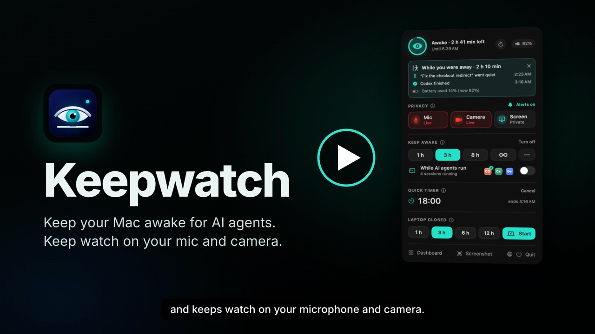
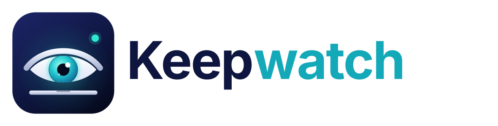
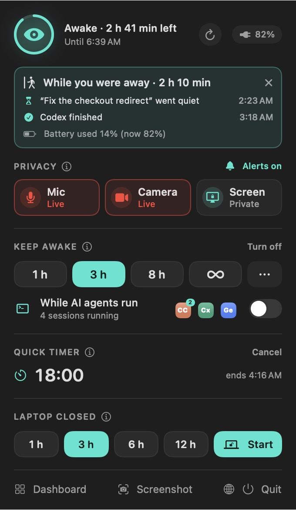
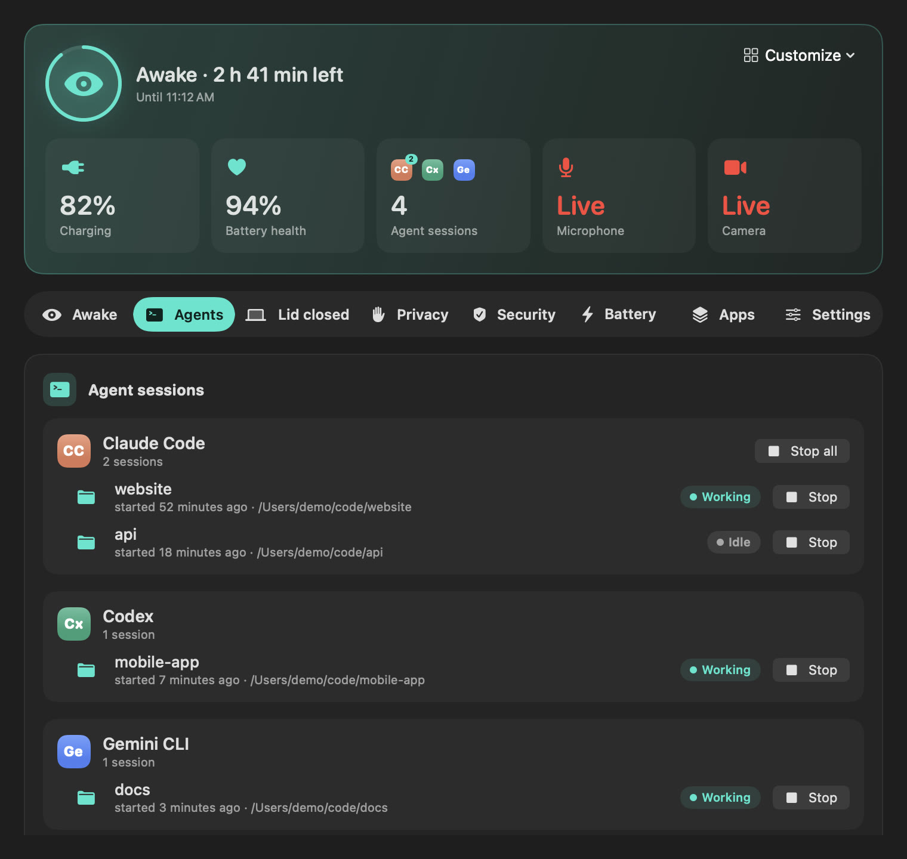

**Keepwatch in 95 seconds** (narrated tour of 0.3, demo data). Click to play:

<a href="https://github.com/AgentSkillDeck/keepwatch/releases/download/v0.3.0/keepwatch-tour.mp4"></a>

<sub>With chapters on the <a href="https://agentskilldeck.github.io/keepwatch/#tour">website</a> · Music: “Soft Corporate” by MusicLFiles, CC BY 4.0 · Voice: Supertonic 3, generated on device</sub>

# Keepwatch

<p align="center">
  <picture>
    <source media="(prefers-color-scheme: dark)" srcset="assets/logo-dark.svg">
    
  </picture>
</p>

[](https://github.com/AgentSkillDeck/keepwatch/actions/workflows/ci.yml)

A native macOS menu-bar app that keeps your Mac awake for AI coding agents, even with the lid closed, and keeps watch on your mic and camera.

**Keepwatch in 95 seconds** (narrated tour, demo data):

https://github.com/user-attachments/assets/15249e04-ae40-4b3f-8cc4-2ddb3411619d

<sub>Also on the <a href="https://agentskilldeck.github.io/keepwatch/#tour">website</a> with chapters · <a href="https://github.com/AgentSkillDeck/keepwatch/releases/download/v0.3.0/keepwatch-tour.mp4">MP4</a> · Music: “Soft Corporate” by MusicLFiles, CC BY 4.0 · Voice: Supertonic 3, generated on device</sub>

<p align="center">
  
  &nbsp;
  
</p>

Built with Swift and SwiftUI for macOS 14 and later. It runs on Apple Silicon and Intel, is signed with a Developer ID, and is not sandboxed.

## Install

**The app:** download `Keepwatch-VERSION.dmg` from the [latest release](https://github.com/AgentSkillDeck/keepwatch/releases/latest) and drag Keepwatch to Applications. Its dashboard installs the `keepwatch` command (**Install the keepwatch command**).

**Command line only:** you can install the `keepwatch` command without the app.

- One line (no sudo; checks the release checksum and the Developer ID signature, then installs to `~/.local/bin`):

  ```sh
  curl -fsSL https://raw.githubusercontent.com/AgentSkillDeck/keepwatch/main/scripts/install-cli.sh | sh
  ```

- Zip: download `keepwatch-cli-VERSION-macos.zip` from the [latest release](https://github.com/AgentSkillDeck/keepwatch/releases/latest), unzip it, and put `keepwatch` on your `PATH`:

  ```sh
  unzip keepwatch-cli-*-macos.zip
  mkdir -p ~/.local/bin && mv keepwatch-cli-*-macos/keepwatch ~/.local/bin/
  export PATH="$HOME/.local/bin:$PATH"   # add this line to ~/.zshrc to keep it
  keepwatch version
  ```

- Homebrew: `brew install agentskilldeck/tap/keepwatch-cli`.

Without the app, `keepwatch awake` and `keepwatch run` hold the Mac awake themselves. Lid-closed sessions (`keepwatch lid start`) need the app, because it shows the password prompt and runs the watchdog.

## What it does

**Stay awake**
- One click for 1 h, 3 h, 8 h, 1 day, or until you turn it off (∞).
- **Custom:** any number of minutes, hours, days or weeks (up to 30 days), or **until** a date and time.
- **While AI agents run** keeps the Mac awake only while Claude Code, Codex, Gemini CLI, Aider, OpenCode, Goose, Amp, Cursor Agent, Qwen Code or Crush is running. After the last one exits, it waits a 2-minute grace period, then lets the Mac sleep.
  - Agents written in JavaScript or Python (Gemini CLI, Qwen Code, Amp, Aider, npm installs of Claude Code or Codex) are found by their script, even though they run as `node` or `python3`. The Cursor editor itself doesn't count; its command-line agent (`cursor-agent`) does.
- Claude Code's idle helpers (the pre-warmed `--bg-spare` process and `claude daemon`) don't count, so they can't keep the Mac awake forever.
- **Session names:** Claude Code and Codex sessions show the name the agent gave them (Claude Code's title, Codex's thread name); other agents show their folder. Stop any session from the menu (click ⊗ twice) or the Agents tab.
- A notification tells you when an agent finishes, and when a session goes quiet it names it ("“Fix the checkout redirect” is waiting"). Clicking it brings forward the terminal the agent runs in.
- **While you were away:** when you come back (screen wakes or you unlock), the menu shows what happened: agents that finished or started waiting, a lid session that ended, and the battery it cost.
- Lid sessions show the Mac's temperature and end early if it gets hot.
- It shows which other apps are also holding the Mac awake (Amphetamine, caffeinate, and so on).
- Optional: **stop when unplugged**, and **stop at 15% battery** (on by default).
- Optional: **stay awake automatically while plugged in**, or **while an external display is connected**.
- **Shortcut ⌃⌥⌘K** turns keep-awake on or off from any app (no Accessibility permission needed).
- **Screenshot (⌃⌥⌘S, or the menu button)** opens Apple's screenshot toolbar: an area, a window or the whole screen, as a picture or a video, with Markup to edit it. Apple's app does the capture, so Keepwatch needs no Screen Recording permission.

**Quick timer**
- 5, 10, 15, 25 or 45 minutes from the menu, with the countdown in the menu bar and a "Time's up" notification. Handy for a break, a build or a pomodoro.

**Agents**
- **Time limit per session** (off, 1, 2, 4 or 8 h): tells you when an agent has run that long, or stops it if you choose, for sessions left running by mistake.
- An **Agents** tab lists every session, grouped by assistant (Claude Code, Codex, Gemini CLI…), with its name (Claude Code sessions), folder, when it started, and whether it is **working** or **idle** right now.
- **Stop** one session or all sessions of an assistant, after a confirmation. Keepwatch checks the process is still that agent before it signals it.
- A notification when an agent **goes quiet** after working: it may be done, or waiting for your answer.

**Lid-closed sessions (beta)**

> Beta: the watchdog is tested by running its real shell loop against stub tools, but lid sessions have had little real-world use. Try one plugged in first: start a session, check that `pmset -g | grep SleepDisabled` shows `1`, click **End lid session**, and check that the line disappears within a few seconds.

- Keeps agents running with the lid shut, then puts the Mac to sleep by itself. Choose:
  - sleep **N hours after the lid closes** (opening the lid resets the timer), and/or
  - sleep **at a set time** (for example, tonight at 1:00),
  - end **when all agents finish**,
  - on battery only above 20% (you can turn battery off entirely), and it stops at 20%,
  - a **12-hour hard cap** in every case.
- It asks for your password **once**, when you start a session. That one admin command turns sleep off and starts a small root watchdog as its own launchd job, so it doesn't depend on Keepwatch or the password prompt staying open. The watchdog alone turns sleep back on and sleeps the Mac, so it works with the lid shut and even if Keepwatch crashes or quits.
- Keepwatch ends a session early without a password (agents done, Mac running hot, you click End) by dropping a stop file that the watchdog checks every 2 s.
- On launch, Keepwatch checks the real `pmset` state:
  - If sleep is still off from an earlier session whose watchdog is gone (after a restart, say), it offers to turn sleep back on.
  - If something else turned sleep off, it says so.

**Privacy**
- A red **mic and camera badge** in the menu bar while either is live: 
- **Which app is using the mic**, from CoreAudio's process list (macOS 14+).
- A **mic switch** that mutes every connected mic (built-in, AirPods, USB…) for every app, and names any mic that has no mute control. The mic and camera rows show which device is live.
- **Camera status**, with **Turn off…** while it is live: macOS has no switch that turns the camera off for every app, so this opens the Camera list in System Settings, where switching an app off stops it using the camera. Also an alert when the mic or camera turns on, and **Reset camera access**, which makes every app ask again.
- A **history** of when the mic and camera turned on and off, kept only on this Mac, and **By app**: how many times and how long each app used the mic or camera today, in 7 days or in 30 days.
- **Screen Sharing alert:** a red warning (and a notification) while someone is connected to this Mac with Screen Sharing or Remote Management. Apps that record the screen themselves get macOS's own purple indicator; there is no public way for another app to see those.
- **Security checks** (read-only): firewall, FileVault, Gatekeeper, System Integrity Protection, AirDrop.
- **Mute the mic when the lid closes** or **when the screen locks**, and unmute it when you're back.
- **Activity log** (Settings › Activity log): every change Keepwatch makes to your Mac or other apps, such as sleep settings, lid sessions, the mic, quitting apps, stopping processes, Mac tweaks, updates and permission requests. It stays on this Mac, readable by you alone, up to 1,000 entries, with Copy and Clear.
- One-click links to the System Settings privacy lists: Camera, Microphone, Screen Recording, Accessibility, Full Disk Access, Automation, Location.
- Keepwatch needs **no** mic, camera or Full Disk Access permission. Accessibility is asked for only if you turn on **Stay active**. It never captures anything; it only asks the system whether a device is running.

**Stay active in chat apps (opt-in)**
- Slack, Teams, Zoom and similar apps mark you away after a few minutes with no input, even when the Mac is awake. **Stay active** (Stay awake › Laptop open) moves the pointer 1 pixel when you've been idle for 2, 4 or 9 minutes, like Amphetamine's cursor option. It never clicks or types, never runs during a lid session, and needs Accessibility, which Keepwatch asks for only when you turn it on.

**Menu and updates**
- You choose what the menu shows (Settings › Menu): privacy, keep awake, a quick timer, laptop closed, agent sessions by name, and the apps using the most memory. Other keep-awake lengths are under **⋯**, with a custom time and Turn off.
- **Refresh** (⌘R) reads everything again now. Dashboard, Screenshot and the website link close the menu first.
- **Stay awake** has two sub-tabs: **Laptop open** (stops the Mac sleeping while you're away; no password) and **Laptop closed** (keeps working with the lid shut, then sleeps by itself; needs your password to start).
- Lid sessions show the time left and whether the watchdog is running. If the watchdog stops while sleep is off, or doesn't answer **End lid session**, Keepwatch asks for your password and turns sleep back on itself.
- **Check for updates** in Settings, and an optional daily check (off by default). **Install and relaunch** downloads the new version from the GitHub release and installs it only if its checksum matches, it is signed by Keepwatch's Developer ID and notarized by Apple. The old app goes to the Trash. Nothing installs unless you click.

**Dashboard**
- A summary you choose: battery, health, agent sessions, mic, camera, CPU, memory, temperature, cycles, time left, ports, security, free disk. Six to a row; click one to open its tab.
- Tabs: Awake, Agents, Lid closed, Privacy, Security, Battery, Apps, Settings (⌘1–⌘8).
- Battery charge, source, time left, **health** (% of original capacity), cycle count, Low Power Mode, thermal state and lid state.
- **Apps using the most memory**, grouped by app (Chrome's helpers count as Chrome), with a confirmed **Quit** that works like ⌘Q. macOS's own processes can't be quit.
- **Listening ports**: your processes listening on TCP ports, with a confirmed Stop. Stop is hidden for macOS's own processes.
- **Battery health over time**: one reading a day, kept on this Mac.
- **Charge limit:** a shortcut to macOS's own charge limit (Battery settings), which stops charging at 80–100% to slow battery wear.
- **Storage** (Apps › Storage): free space, a warning once a day when it drops below 5, 10, 20 or 50 GB, and the developer and cache folders that use the most (Xcode build files, simulators, caches…) with Show in Finder. Read-only: Keepwatch never deletes files, and doesn't read Downloads, the Trash or other apps' data, so macOS never asks for permission.
- **Startup items** (Security › Startup items): programs that start by themselves (launch agents and daemons), with a notification when a new one appears. Your own can be removed (stopped and moved to the Trash) after two clicks.
- Quick settings: Dock autohide, show hidden files, show all file extensions.
- Open at login, plus a link to manage all login items.

**Command line, for you and your AI agents**

Install it from the dashboard (**Install the keepwatch command**) or on its own (see [Install](#install)), then:

```sh
keepwatch run -- npm test          # stay awake exactly while a command runs (exit status passes through)
keepwatch awake --agents           # stay awake while Claude Code, Codex, … run
keepwatch awake --for 3h           # 45m, 1h30m, 2d, 1w… (max 30 days); or --until 18:30, or --off
keepwatch status --json            # power, sleep blockers, agents, mic/camera, lid
keepwatch agents [--json]          # each session: agent, pid, folder, working or idle, and its name
keepwatch agents stop PID          # quit one agent session
keepwatch privacy [--json]         # mic and camera now, plus history
keepwatch security [--json]        # firewall, FileVault, Gatekeeper, SIP, AirDrop
keepwatch apps [--json]            # your apps by memory use
keepwatch ports                    # what's listening on which port
keepwatch lid start --hours 3      # asks the app; you type your password in the macOS prompt
keepwatch lid end                  # end a lid session
```

**Agent skill:** [`skills/keepwatch/SKILL.md`](skills/keepwatch/SKILL.md) teaches Claude Code, Codex and other agents to use it safely: `npx skills add AgentSkillDeck/keepwatch`.

**Automation (Shortcuts, Raycast, scripts)**

```sh
open "keepwatch://awake?for=3h"       # keep awake 3 h (max 30 days); ?minutes=90 also works
open "keepwatch://awake"              # until turned off
open "keepwatch://awake/agents"       # while AI agents run
open "keepwatch://awake/off"
open "keepwatch://mic/mute"           # or mic/unmute
open "keepwatch://lid/end"            # end a lid session (restores sleep)
open "keepwatch://dashboard"
open "keepwatch://timer?minutes=25"   # quick timer (or timer/cancel)
```

Starting a lid session is deliberately **not** available by URL, so a web page can never put a password prompt in front of you. `keepwatch lid start` uses a local channel instead, and still needs your password.

## Safety

- Lid-closed mode changes a persistent system setting (`pmset disablesleep`). While the Mac is running, the watchdog's deadline, the 12 h cap, the battery rules and the thermal cut-out all end it.
- **Known gap: a restart during a session.** `SleepDisabled` survives a reboot and the watchdog doesn't. Keepwatch spots this on its next launch (it compares boot time with the session start) and offers to turn sleep back on. Until Keepwatch is opened, though, the Mac won't sleep, so turn on **Open Keepwatch at login** if you use lid sessions. A privileged helper (roadmap) will close this gap.
- The password is asked only when a lid session starts: when you click **Start lid session**, or when you or an agent run `keepwatch lid start`. Either way macOS shows its own prompt and only a person at the Mac can approve it.
- Nothing reads TCC.db and no permission is granted silently.

## Build, sign, notarize

```sh
swift test                      # 101 unit, watchdog (launchd), updater and read-only tests
scripts/build-app.sh            # dist/Keepwatch.app (universal)
scripts/sign.sh                 # Developer ID + hardened runtime + timestamp
# one-time: store notarization credentials in your keychain
xcrun notarytool store-credentials keepwatch-notary --apple-id YOU@EXAMPLE.COM --team-id S99G3X6RPM
scripts/notarize.sh [profile]   # notarize, staple, zip -> dist/Keepwatch-VERSION.zip
scripts/make-dmg.sh [profile]   # signed, notarized, stapled dist/Keepwatch-VERSION.dmg
scripts/make-cli-zip.sh         # unsigned dist/keepwatch-cli-VERSION-macos.zip (universal); prints the signing steps
(cd dist && shasum -a 256 Keepwatch-*.zip Keepwatch-*.dmg > SHA256SUMS.txt)
```

To review the UI without a screen capture: `dist/Keepwatch.app/Contents/MacOS/Keepwatch --render-snapshots /tmp/kw` writes light and dark PNGs of the menu and dashboard.

## Layout

- `Sources/KeepwatchCore`: logic and thin system wrappers, unit-tested. Covers power assertions, `pmset` parsing, agent detection, the keep-awake engine, the lid-mode policy, the lid watchdog builder, the privacy monitor, power state, quick toggles, listening ports and URL commands.
- `Sources/Keepwatch`: the SwiftUI app (menu-bar extra, dashboard, app model).
- `Tests/KeepwatchCoreTests`: includes a test that runs the real watchdog shell loop against stub `pmset` and `ioreg` binaries.
- `Sources/KeepwatchCLI`: the `keepwatch` command.
- `skills/keepwatch`: the agent skill.
- `packaging/homebrew`: the Homebrew formula for the CLI alone.
- `docs/`: the design doc and research notes.
- `AGENTS.md`: strict rules for agents developing Keepwatch.

## Licence

Apache-2.0. See [LICENSE](LICENSE) and [NOTICE](NOTICE). Report security issues as described in [SECURITY.md](SECURITY.md).
